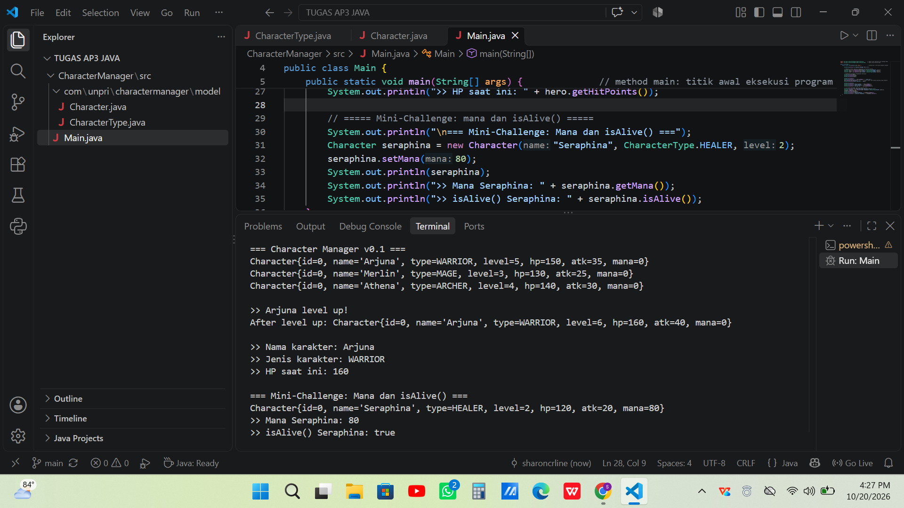

# Character Manager — TP3 (Java Visual SIH-6406)

Proyek ini adalah fondasi model class untuk aplikasi manajemen karakter game, ditulis dengan Java. Class `Character` menyimpan nama, jenis (enum `CharacterType`), level, hit points, attack power, dan mana, dengan statistik yang dihitung ulang otomatis saat level berubah. `Main.java` mendemonstrasikan pembuatan karakter, level up, serta fitur `mana` dan `isAlive()`.

## Screenshot Output



## Struktur Folder

```
javavisual-tp03-253303621274/
├── README.md
├── screenshots/
│   └── output.png
└── CharacterManager/
    └── src/
        ├── Main.java
        └── com/
            └── unpri/
                └── charactermanager/
                    └── model/
                        ├── Character.java
                        └── CharacterType.java
```

## Identitas

- Nama lengkap: Sharon Caroline Pardede
- NIM: 253303621274
- Analisis Bagian D (Google Docs): https://docs.google.com/document/d/1yYdo21ZE7nsQV2AhI6MQIll55f2BvhbNuB61EUNBLZk/edit?usp=sharing