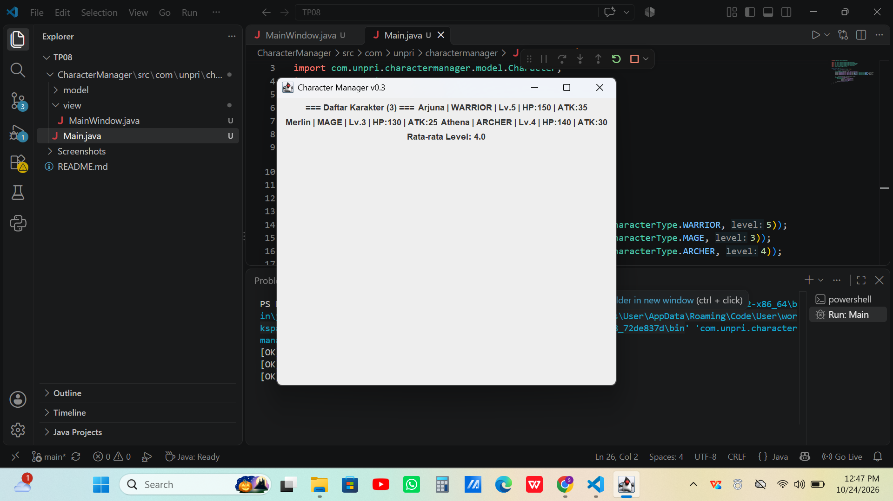
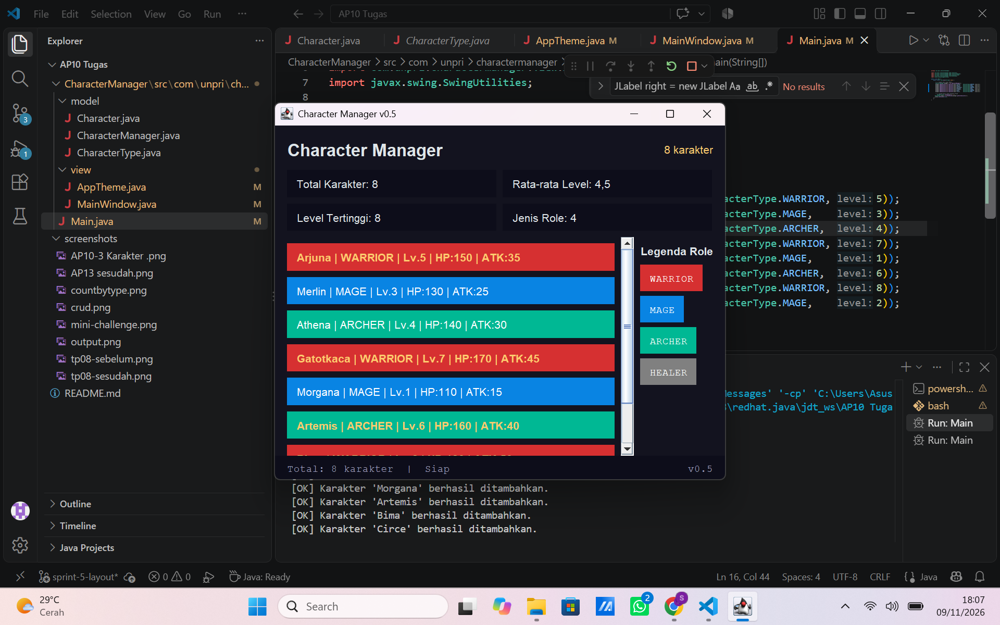
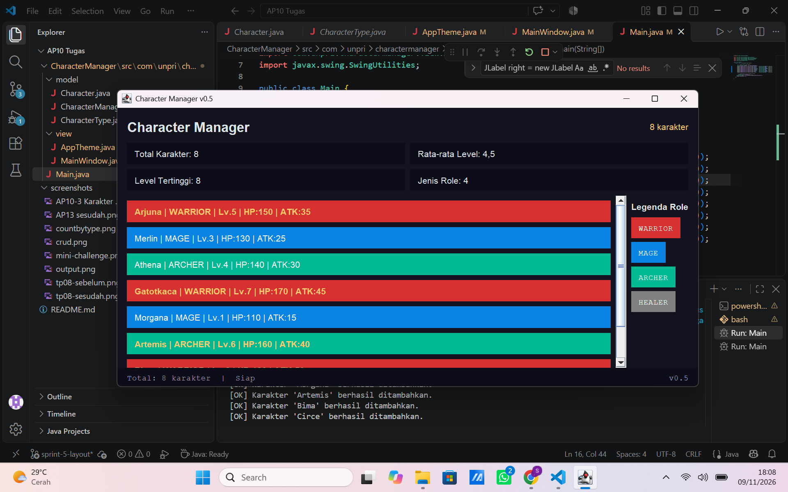
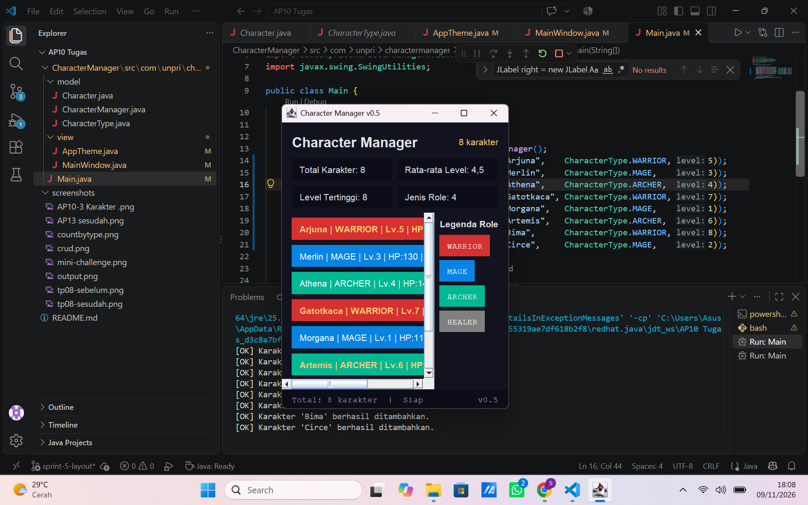

## TP10 - Theming, Properti Komponen & Analisis MVC

### Tampilan Sebelum dan Sesudah

**Sebelum (MainWindow v0.3)**



Versi v0.3 menampilkan daftar karakter menggunakan tampilan sederhana
tanpa tema warna kartu berdasarkan role.

**Sesudah (MainWindow v0.4)**


Versi v0.4 menggunakan tema gelap dengan warna kartu berbeda sesuai role
karakter. Karakter dengan level 5 atau lebih ditampilkan menggunakan teks
berwarna emas dan tebal. Aplikasi juga menggunakan tooltip dan perubahan
cursor sebagai properti tambahan.

### Implementasi AppTheme

Pengaturan tampilan aplikasi dipusatkan di `AppTheme.java` yang berada
di package `view`. AppTheme menyediakan palet warna, font, border, serta
method `colorFor()` untuk menentukan warna kartu berdasarkan role karakter.

`MainWindow` menggunakan pengaturan dari AppTheme untuk menampilkan judul
dan kartu karakter. Kartu karakter menggunakan `setOpaque(true)` agar warna
latar terlihat, sedangkan ukuran jendela menyesuaikan komponen menggunakan
`pack()`.

### Mini-Challenge: Level Tinggi

Karakter dengan level 5 atau lebih mendapatkan teks berwarna emas dan tebal.
Batas level tinggi disimpan dalam konstanta bernama
`HIGH_LEVEL_THRESHOLD` di AppTheme.

Karakter yang memenuhi kondisi tersebut antara lain Arjuna (level 5),
Gatotkaca (level 7), dan Ranger (level 6).

### Properti Komponen Tambahan

**1. Tooltip (`setToolTipText()`)**

Tooltip menampilkan penjelasan singkat mengenai role karakter ketika cursor
diarahkan ke kartu. Properti ini membantu pengguna memahami karakter tanpa
menambah banyak teks pada tampilan utama.

**2. Cursor (`setCursor()`)**

Cursor diubah menjadi bentuk tangan menggunakan `Cursor.HAND_CURSOR`
ketika diarahkan ke kartu karakter. Hal ini memberikan petunjuk visual
kepada pengguna bahwa komponen tersebut memiliki potensi interaksi.

### Pemisahan Warna dalam MVC

Warna disimpan di `AppTheme` karena warna merupakan bagian dari pengaturan
tampilan aplikasi yang termasuk tanggung jawab layer View. `Character`
sebagai Model hanya menyimpan data karakter seperti nama, role, level,
HP, dan ATK.

Dengan memisahkan warna dari Model, data karakter dapat digunakan kembali
pada tampilan yang berbeda tanpa bergantung pada aturan visual tertentu.
Selain itu, perubahan tema dapat dilakukan di AppTheme tanpa perlu
mengubah kode Model. Pemisahan ini menjaga prinsip MVC, yaitu Model
mengelola data dan logika bisnis, sedangkan View bertanggung jawab
terhadap tampilan.

### Analisis Properti & MVC (Bagian D)

Link Google Docs: https://docs.google.com/document/d/1BlCfHTOSXwXQEibUCTakaCCLW-2-DNsKCJT1Lels13A/edit?tab=t.0

---

# TP12 - Layout Manager, Responsive UI & Analisis Layout
## 1. Wireframe Layout

Struktur tampilan aplikasi Character Manager v0.5:

```text
+------------------------------------------------------+
| HEADER: Character Manager              8 karakter    |
+------------------------------------------------------+
|                  STATISTICS PANEL                    |
|  Total Karakter       | Rata-rata Level              |
|  Level Tertinggi      | Jenis Role                   |
+--------------------------------------+---------------+
|                                      |               |
|          DAFTAR KARAKTER             |    LEGENDA    |
|          (JScrollPane)               |     ROLE      |
|                                      |               |
+--------------------------------------+---------------+
| STATUS: Total 8 karakter | Siap                 v0.5 |
+------------------------------------------------------+
```

## 2. Screenshot Hasil Pengujian

### A. Tampilan Ukuran Normal


### B. Tampilan Jendela Diperlebar


### C. Tampilan Jendela Dikecilkan


## 3. Observasi Responsive Layout

Pengujian dilakukan dengan mengubah ukuran jendela aplikasi untuk melihat
perilaku komponen saat ukuran layar berubah.

| Kondisi Jendela | Prediksi | Hasil Pengamatan |
|---|---|---|
| Ukuran normal | Komponen tampil sesuai susunan layout yang ditentukan. | Header, statistik, daftar karakter, legenda, dan status bar terlihat. |
| Jendela diperlebar | Ruang horizontal bertambah dan komponen menyesuaikan ukuran. | Tampilan menjadi lebih lebar tanpa mengubah susunan utama. |
| Jendela dikecilkan | Ruang daftar karakter berkurang dan scrollbar dapat muncul. | Scrollbar muncul sehingga daftar karakter tetap dapat diakses. |

## 4. Penjelasan Nested Panels dan Layout Manager

Aplikasi Character Manager menggunakan beberapa panel yang disusun secara bertingkat (nested panels). JFrame utama menggunakan BorderLayout untuk membagi area menjadi bagian header, daftar karakter, legenda, dan status bar. Pada bagian atas, createTopPanel() menggunakan BoxLayout dengan orientasi Y_AXIS untuk menyusun header dan statistics panel secara vertikal. Statistics panel menggunakan GridLayout (2, 2) agar empat informasi statistik tersusun rapi dalam dua baris dan dua kolom.

GridLayout dipilih karena setiap informasi statistik memiliki ruang yang sama sehingga tampilannya konsisten. FlowLayout tidak dipilih karena susunan komponen dapat berubah mengikuti ruang horizontal yang tersedia dan kurang sesuai untuk tampilan statistik berbentuk grid.

## 5. Dokumentasi Analisis TP12

Analisis lengkap mengenai Layout Manager, Responsive UI, dan pemisahan Model-View dapat dibaca melalui dokumen berikut:

[Google Docs - Analisis Java Visual TP12](https://docs.google.com/document/d/1-JaRKtNzQc1xXzvFG3SHxZ1jcrnBT79qrUipQl1pBtk/edit?usp=sharing)